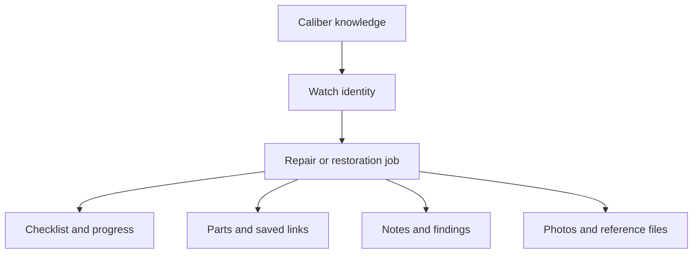
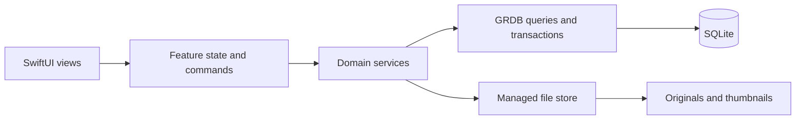

# Watch workshop app specification

Version 0.13. Updated on 5 November 2026. This is the first-release contract for review. The current-platform direction, app foundation, and W002 SQLite/GRDB storage design were approved on 1 October 2026. The user approved the shared caliber design and repair history rule on 2 October 2026. On 24 October 2026 the user removed supplier details, price, currency, and supplier selection from part links. A part link holds only its URL. A watch can have several jobs, with at most one open job. W005 uses the existing Save and Cancel editing pattern. Other proposed defaults are not yet an approved product baseline. PDF report creation is deferred. Parts must accept saved links. On 4 November 2026 the user approved the Rework designed in the Paper page "Rework · Simple", delivered as W033 to W042. W033 replaces separate note records with one notes text per watch, caliber, and job that saves as you type. W035 makes the caliber page a page you write on, with each fact saved in place. W036 does the same for the watch page, moves the owner and contact from the job to the watch, and lets any watch be archived. W037 gives a job three states, In progress, Waiting and Done, removes the activity history, and makes the job page a page you write on.

Build a native Mac app that keeps a watch's identity, repair work, and supporting evidence together. A watch is a lasting record. A job is one repair or restoration of that watch. A caliber is reusable technical knowledge. All app data stays on the Mac. The user chooses when to open an external link or export a file.

## 1 Product decisions

### Confirmed requirements

- Store watch names, calibers, and other specifications.
- Store technical sheet links, research, and photos.
- Plan work with a checklist and visible progress.
- Record the watch's state.
- Track required parts with descriptions, reference numbers, one or more optional saved links, and purchase states. Links can point to product listings, suppliers, or identification references.
- Support overview, active bench work, and records that can help a customer.
- Build a native macOS app with local storage first.
- Leave a practical route to cloud sync later.
- Divide implementation into small issues that agents can deliver as separate PRs.

### Approved platform direction

- Target macOS 27 and Apple silicon. Older macOS releases and Intel Macs are outside the target.
- Use Xcode 27, the macOS 27 SDK, and Swift 6.4 in Swift 6 language mode.
- Use SwiftUI Observation, native navigation and controls, complete concurrency checks, approachable concurrency, and main-actor isolation by default. Move database, file, and image work off the main actor.
- Use Ure as the working app name. The local bundle identifier is local.ure.app; settle an owner-controlled identifier before distribution and before storing valuable data.
- Measure performance with optimized builds and realistic datasets. New technology alone is not evidence that the app meets its performance targets.

### Proposed defaults

These choices make the draft concrete. They are recommendations, not user approvals.

| Decision | Proposed first version |
| --- | --- |
| Repair history | Approved on 2 October 2026: several jobs per watch; at most one open job per watch |
| Customers | Approved on 4 November 2026: an optional owner and one free-text contact on the watch, typed once per watch; work notes and outcomes for later reference. No customer records or contact book |
| Shared knowledge | Approved on 2 October 2026: reusable caliber records linked to several watches; notes, photos, PDF files, and links follow in their own issues |
| Native stack | Approved: Swift 6 and SwiftUI Observation; AppKit and PDFKit where needed |
| Persistence | Approved: SQLite through GRDB; photos and PDFs in app-managed files |
| Minimum system | Approved: macOS 27 on Apple silicon; no older-system compatibility layer |
| Distribution | Run locally from Xcode first; store distribution and automatic updates are later work |
| Editing | Approved on 4 November 2026: the Rework moves every record to edit in place with autosave and Undo. W033 starts with notes, W035 does the caliber page, W036 the watch page, W037 the job page, and W039 the checklist. The part editor keeps Save and Cancel, Cmd-S, and unsaved-draft protection until W040 replaces it |
| Notes | Approved on 4 November 2026: one plain-text notes text per watch, caliber, and job that saves as you type; no rich text, Markdown rendering, or note history. Clickable links within text remain proposed |
| Measurements | Written notes and attached instrument photos in version 1; structured measurement forms later |
| Parts cost | Not tracked. Supplier price and currency were removed on 24 October 2026; no job accounting or invoice totals |
| Naming | Ure is the working title; distribution identity remains to be settled |

If the repair history or shared caliber rules change, revise the model and dependent issues before implementation. Do not build both alternatives.

### Outside the first release

PDF report creation and export, accounts, cloud services, device sync, mobile clients, collaboration, billing, quotes, invoices, automatic supplier ordering, stock control, AI identification, OCR, website scraping, image annotation, time tracking, recurring reminders, repair templates, structured test instruments, and importing other apps' databases are outside this release. These features have no placeholder UI.

## 2 Mental model

The arrow from caliber to watch means that the watch can refer to a caliber. A caliber can serve several watches. Files and notes can belong to a caliber, a watch, or a job. The UI labels this scope. It never silently copies shared knowledge into a job.

Separate three meanings of state:

| Indicator | Question it answers | Example |
| --- | --- | --- |
| Job stage | Where is this repair in the workflow? | Waiting |
| Watch notes | What is the watch like now? Written in its notes since W036 | Disassembled |
| Checklist progress | How many steps are ticked? | 6 of 10 done |

Changing one does not change the others. A step count is not an estimate of remaining effort.

## 3 Main user journeys

### Add a watch and start work

Create a watch with a name only. All other specifications can remain unknown. Add the brand, model, case reference, serial number, caliber, owner, and contact when they are known. Start a job and write its title and what is wrong with the watch. Add initial photos. Anything else goes in the job's notes.

### Plan and source

Type the checklist in the order the work will be done, with headings such as Inspection, Disassembly, Cleaning, Assembly, and Testing where they help. These are the user's own words. Add required parts and save links to listings or references. Mark uncertain compatibility explicitly.

### Work at the bench

Open a job. Keep the checklist visible beside a pinned photo or technical PDF. Zoom and pan a photo. Move between photos with the keyboard. Read a PDF without leaving the app. Add dated notes and record findings as the work develops. Save partial knowledge without inventing missing specifications.

### Pause and resume

Set a job to Waiting and say what it waits for. The workshop overview shows that text, how many steps are done, and parts still required. Return later and open the same job and reference item. Restarting the app retains saved content and the last selected job. Window size and reference selection are preferences, not repair history.

### Finish and retain history

Write the outcome, the work performed, and recommendations in the job's notes, and set the job to Done. Unticked steps and unresolved parts stay as they are. Keep these records available for later customer questions. A later repair creates a new job for the same watch. A Done job stays editable. Report creation can be added in a later release.

## 4 Screens and interaction

Use standard macOS controls, system typography, native menus, keyboard focus, and system light and dark appearances. Do not build a browser-style administration dashboard.

### Main window

The sidebar contains Workshop, Watches, Calibers, and Parts. Settings is in the app menu. A middle list shows the selected section's records. The detail area shows the selected record. A search field filters the current section. A separate global search action returns grouped results.

At a proposed minimum window size of 1000 by 650 points, show the list and detail without clipped controls. The optional reference pane can collapse. At larger widths it can sit beside the checklist or notes. The app has one main editing window in version 1. A reference window may be opened read-only.

### Workshop

Show open jobs grouped by In progress and Waiting. Each row has a watch thumbnail, watch and job names, state, checklist progress, what a waiting job waits for, and unresolved part count. Filters support stage and text. Default order is most recently updated. An open job stays here when its watch is archived. Done jobs are available on their watch's page and in search.

### Watch detail

The watch page is a page you write on, laid out as the "4 Watch" artboard. It has no editor, Save, or Cancel. The header shows the watch's cover, its name as the title, and its open job, which opens the job. Clicking the cover chooses a photo from the watch or its jobs. The name in the title is written in place. Then come the facts in three columns: brand, model, and reference; serial, year, and caliber; case, diameter, and lug width; owner and contact. Each fact is written in place and saves on its own. The caliber is a pop-up of the calibers that are not archived, and its arrow opens the caliber's page. As you type a brand, the brands in the library show under the field. Then come the jobs, newest first, with their stage, checklist progress, and date, then the material with the caliber's material as chips, and the notes with the date the watch was last edited. A watch with no open job offers Start Job under its jobs. The app does not automatically create a second open job. Cmd-N in Watches makes a watch named "New Watch", selects it, and puts the cursor in its name with the name selected, so typing replaces it.

The list shows each watch's cover, name, and its brand, year, and open job, such as "Omega · 1958 · In progress", in order of name. The toolbar's subtitle counts the watches and the archived ones, such as "12 watches · 3 archived". Archived watches fold away in a collapsed Archived section at the end of the list, with their count and a trailing chevron. An archived row reads quieter and says when it was archived, such as "Smiths · archived 3 Nov". Selecting an archived watch, also from search, opens the section. An archived watch's page reads as "4b Archived watch": it says "Archived 3 November" under the name, its facts and notes are read-only, and the toolbar offers Unarchive.

### Job detail

The job page is a page you write on, laid out as the "2 Job" artboard. It has no editor, Save, or Cancel. The header shows the cover of the job's watch, or the job's first photo when the watch has none. Beside it are the state as a pop-up with the date the job opened and how long ago, such as "Opened 12 October · 23 days", the title, and a line with links to the watch and its caliber and the owner and contact from the watch, such as "Grandfather's Seamaster › · Omega 552 › · Ana Ribeiro, +351 912 480 117". A Done job's line says when it was done, such as "Opened 12 October · Done 2 November". The title is written in place. A waiting job shows **Waiting for** under the header, written in place. Then come the problem in the job's own words, the parts, the checklist, the material, and the notes with the date the job was last edited. The parts keep their current rows until W040. The checklist is laid out as on "2 Job": the heading says how many steps are done, such as "6 of 10 done", over a thin bar that fills in the same proportion, then the steps with their tick boxes and the headings between them, then a row that says "Add a step". You type it like a note, as on the "Steps and parts" card of "7 Typing". Typing in the last row makes a step there. Return starts the next step, and Return on a step without text moves on, like Tab. Backspace on a step without text removes it and puts the cursor at the end of the step before. A line that starts with "#" and a space becomes a heading, and Backspace on an empty heading makes it a step again. The Up and Down arrows move between the lines. Shift-Cmd-U ticks or unticks the step, and Ctrl-Cmd-Up and Ctrl-Cmd-Down move it. A click on a tick box ticks or unticks its step. The step you type in has a soft accent fill, and the keys show under the checklist while you type. Each step's right-click menu and the Checklist menu offer Tick Step or Untick Step, Make Heading or Make Step, Move Step Up, Move Step Down, and Delete Step. Start Job under a watch's jobs makes a job named "New Job", In progress, and puts the cursor in its title with the title selected, so typing replaces it. The reference pane can display a job, watch, or caliber item while another section remains open.

### Parts overview

Show parts from open jobs. Filter by Needed, Ordered, Arrived, Installed, or Cancelled. Each row names its job and watch. An action opens that part's job. Saved links open in the default browser only after a user action.

### Caliber detail

The caliber page is a page you write on, laid out as the "5 Caliber" artboard. It has no editor, Save, or Cancel. The header shows the caliber's first photo, its maker and name as the title, such as "Omega 552", and where it is used, such as "In 2 watches · 1 job open". The name in the title is written in place. Then come the facts in three columns: maker, winding, beat rate, jewels, power reserve, and lift angle. Each fact is written in place and saves on its own. Winding is a pop-up. Then come the watches that use the caliber, with their brand, year and open job, its material, and its notes with the date the caliber was last edited. Cmd-N in Calibers makes a caliber named "New Caliber", selects it, and puts the cursor in its name with the name selected, so typing replaces it. The list shows each caliber's maker and name, its winding and how many watches use it, in order of maker and name. Editing shared content affects future viewing from those watches. Archived calibers fold away in an Archived section at the end of the list, as archived watches do, and an archived caliber's page offers Unarchive in the toolbar.

### Save and failure behavior

Notes save as you type. A change saves half a second after typing stops, again when focus leaves the notes, and before the window closes or the app quits. Cmd-Z undoes a notes change, even after it saved, and Shift-Cmd-Z redoes it. Esc puts back the notes as they were when focus entered them. A failed notes save keeps the text on screen, says that it did not save, and offers Try Again. Quitting while a notes save has failed asks before it quits. Leaving the notes asks nothing. The autosave lives in the feature state layer, so later Rework stories reuse it for other fields. Material titles use it too.

A fact on a record page, such as a caliber's beat rate, a watch's owner, or a job's title, problem, or waiting text, saves the same way: half a second after typing stops, when focus leaves the fact, and before the window closes or the app quits. Cmd-Z undoes a fact change after it saved, and Shift-Cmd-Z redoes it. Esc puts back the fact as it was when focus entered it. Tab and Shift-Tab move between facts in reading order, and Return in a one-line fact moves to the next one. Validation runs when focus leaves a fact. A value the fact does not take stays on screen and shows as not valid yet, with a message that says what to enter, such as "Enter a beat rate above 0 vph." As you type a maker, the makers in the library show under the field, and Tab or Return takes the first. The record keeps its last good value until the fact is corrected, and Undo never brings back a value that is not valid. Quitting while a fact is not valid or did not save asks before it quits. Leaving the record asks nothing.

Forms that the Rework has not replaced yet show Save and Cancel. Cmd-S saves the active editor. Navigation, window closure, and app termination with an unsaved draft offer Save, Discard, or Stay. A failed save keeps the draft and shows a useful error. Buttons become disabled during their own pending operation. A success state appears only after persistence succeeds.

A checklist saves the same way as a fact: a step's text half a second after typing stops and when focus leaves it, and a tick, a heading, a move, or a removal at once, also before the window closes or the app quits. Cmd-Z undoes each burst of typing in a step and each other change, even after it saved, and Shift-Cmd-Z redoes it. Esc puts back the step's text as it was when focus entered it. A failed save keeps the steps on screen, says that the checklist did not save, and offers Try Again. Quitting while a checklist has not saved asks before it quits. Leaving the job asks nothing.

## 5 Records and validation

All durable records use application-generated UUIDs. Created and updated times are UTC instants. Display dates use the user's system locale. Model references, serial numbers, and part numbers are text. Preserve their punctuation and leading zeros. Optional values remain absent rather than using zero or a made-up value.

Use explicit SQL foreign keys. Enable foreign key enforcement on every database connection. Enforce local uniqueness only for internal IDs and defined compound keys. Two watches may legitimately share a name, model, or serial text. The app can warn about possible duplicates without blocking them.

### Watch

Required: ID and display name. Optional: brand, model, case reference, serial, approximate year as text, caliber ID, case material, case diameter in millimetres, lug width in millimetres, owner, and contact. Numeric dimensions must be finite and positive, and they read as numbers do on a caliber page, in millimetres, such as "35", "35mm", or "35,0 mm". A blank name is not valid, and any other blank text is no value. The owner and the contact are free text, because this release never sends messages. A watch can link a caliber that is archived only if it already links it.

Store a cover photo by reference to a photo item belonging to this watch or one of its jobs. Removing that photo clears the cover reference. Archived watches stay in search.

Libraries before W036 also kept a condition, a condition note, a stated water resistance, and specification notes on each watch, and an owner name, email, and phone on each job. The W036 migration gives each watch the owner of its most recent job that names one, with that job's email and phone joined into the contact, such as "ana@example.pt · +351 912 480 117". It writes the watch's removed values into its notes under "From the old record", one line each, such as "Condition: Stopped". Unknown was the default condition, so it is not written. Then it writes each other job whose owner differs, oldest first, as "Job · Full service" followed by "Owner: Ana Ribeiro", "Email: …", and "Phone: …". When the notes already have that heading, the values go under it. Then those fields go. The migration does not change any record's updated time. Activity records kept the conditions they saved until W037.

### Caliber

Required: name, the display designation. Optional: maker, winding, beat rate in vibrations per hour, jewel count, nominal power reserve in hours, and lift angle in degrees. Winding is Manual, Automatic, or Quartz, or empty when nobody has written it down. It is chosen from a pop-up. Numeric fields are optional, finite, and non-negative; nonzero is required for beat rate and lift angle. A blank name is not valid, and a blank maker is no maker. Sources for technical claims go in the caliber's notes. Do not seed unverified technical data.

Numbers accept what you would write on paper, such as "35", "35mm", and "35,0 mm". The Mac's decimal mark separates the fraction. Spaces, the region's grouping mark, and the other of "." and "," group the digits. The last group has three digits and the others two or three, so Indian grouping such as "12,34,567" works too. Digits can be in the region's own script. A unit after the number must be one the fact knows: vph, bph, or A/h for beat rate; jewels, jewel, or j for jewels; h, hr, hrs, hour, or hours for power reserve; and °, deg, degree, or degrees for lift angle. Anything else is not valid yet. Numbers show in the Mac's region format with their unit, such as "28,800 vph" in the United States and "28 800 vph" in Portugal.

Libraries before W035 also kept a variant, a movement type that could be Unknown or Other, specification notes, and a source note. The W035 migration makes Manual, Automatic, and Quartz the winding, and makes Unknown empty. It writes Other, the variant, the specification notes, and the source note into the caliber's notes under "From the old record", one line each, such as "Variant: A/2" and "Movement type: Other". When the notes already have that heading from an earlier migration, the values go under it. Then those fields go. The migration does not change any caliber's updated time. Job intake snapshots kept the variant they saved until W037 wrote it into the job's notes.

### Job

Required: watch ID, title, and state. Optional: the problem, what a waiting job waits for, and the date it was done. The owner and contact are on the watch since W036. The opened date is when the job was created. A blank title is not valid, and any other blank text is no value.

The state is In progress, Waiting, or Done. Only one job that is not Done can exist for a watch. Enforce this rule in both the service and database. Only a waiting job has a waiting text, and only a done job has a done date. The database enforces both.

Libraries before W037 had six stages and kept an intake snapshot, an agreed scope, an intake condition, an outcome, recommendations, a cancellation reason, explanations for unfinished tasks and unresolved parts, and started, completed, and cancelled times, with activity records beside them. The W037 migration makes Planned, In progress, and Ready jobs In progress, keeps Waiting jobs Waiting with their waiting reason as their waiting text, and makes Completed and Cancelled jobs Done, with the time they completed or were cancelled as the done date. It writes the removed values into the job's notes under "From the old record", one line each, such as "Agreed scope: Full service" and "Outcome: Serviced, +3 s/d". A cancelled job's line reads "Cancelled: Owner declined the quote". An intake snapshot value is written only when the watch no longer holds it, such as "Serial at intake: 0012", and a snapshot of another version is written as it was saved. When the notes already have that heading, the values go under it. Then those fields go. The migration does not change any record's updated time.

### Checklist step

A job's checklist is a list of steps in order. Required: job ID, text, and position. A step is ticked or not, or it is a heading, which has no tick. The text is saved without the spaces around it, and a step without text is not saved. A checklist starts empty, and nothing creates or ticks steps for you. Steps and parts are independent, so a fitted part never ticks a step. No nested steps, checklist templates, copying steps from another job, time estimates, or links between steps and parts. The user decided on 4 November 2026 that checklists are typed by hand at first.

Libraries before W039 kept tasks with a title, a detail, a group label, one of five statuses (To do, Doing, Waiting, Done, or Skipped), a waiting reason, a skipped reason, and links to the job's parts. The W039 migration makes each task a step with the same ID, in the same order. Done and Skipped tasks become ticked steps. A group label becomes a heading where the group changes from the task before, so a group that comes back gets its heading again, and a task without a group gets none. Each task's detail, waiting reason, and skipped reason go into the job's notes under "From the old record", after a line with the step's text, such as "Step · Let down the mainspring" and "Skipped reason: Already let down". When the notes already have that heading, the values go under it. Then the statuses, details, reasons, and links between tasks and parts go. The parts keep their own status. The migration does not change any record's updated time.

### Part requirement and links

A part requirement belongs to one job. Required: description and positive whole-number quantity, default 1. Optional: manufacturer name, manufacturer reference, compatibility notes, and saved links. Compatibility is Unchecked, Confirmed, or Unsuitable. Confirmed requires a short evidence note. This records the user's assessment, not an automated guarantee.

Each PartLink belongs to one part requirement. It holds only an HTTP or HTTPS URL. The part editor has an Add link action during creation and later editing. A part can also be saved without links. Show every saved link in the part detail with an Open action. Several links can coexist, including product listings and identification references. Do not keep a duplicate URL field on the part.

Procurement status is Needed, Ordered, Arrived, Installed, or Cancelled. Store the date of each current milestone. Ordering can record an optional order reference. A part can start at Arrived if it was already on hand. Installed is separate from Arrived.

Each line moves as one unit or lot. Partial deliveries and several purchases for the same line are outside version 1. The user can create separate lines for separately tracked quantities. Do not imply partial receipt support with a quantity counter. An ordered lot that needs partial tracking can be split manually into new lines with explanatory notes; the original line is cancelled and retained.

### Notes

Each watch, caliber, and job has one plain-text notes text. It is empty by default. Text is 15 pt with a 24 pt line height and stops at about 75 characters a line. Cmd-D types today's date in the long date format of the user's locale. Saving notes updates the record's updated time and its search key. Text is not rendered as HTML or Markdown. A Done job's notes can change. An archived record's notes stay readable and cannot change until the record is unarchived.

Libraries before W033 kept separate note records with a title, body, kind, and occurred date. The W033 migration joins each record's notes into its notes text, oldest first by occurred date and then created time. Each old note starts on its own line with its date, kind, and title, such as "14 October 2026 · Work log · Mainspring", followed by its body. A blank line separates old notes. Then the note table goes. Nothing typed is lost: when a later Rework story removes a field, its migration writes the value into the owning record's notes under "From the old record". A migration adds that heading only when the notes do not have it yet.

### Material and file assets

Material is a photo, a PDF, or a link. It is stored as a library item that belongs to exactly one watch, job, or caliber. Use three nullable foreign keys with a CHECK constraint requiring exactly one owner. Material keeps its kind, a title, its file or URL, and the date it was added. Kind is Photo, Document, or Link, and the app shows a document as PDF. A link has an HTTP or HTTPS URL and no file. A photo or PDF has a file asset ID and no URL. A new file is titled by its filename. A new link is titled by its host without "www.". The title is required. It is edited in place and saves with the W033 autosave. A blank title keeps the saved one.

Libraries before W034 also kept a photo stage, a caption, a PDF source URL, a source description, and item notes. The W034 migration writes each item's values into its owner's notes under "From the old record", oldest item first. Each item starts on its own line with its kind and title, such as "Photo · Dial at intake", followed by one line per value, such as "Stage: Before". An Unclassified stage was the default, so it is not written. Then those fields go. The migration does not change any record's updated time, and no original file moves or changes.

Removing material keeps its file asset and records it in a removed-file table, so that Undo can bring the material back with its original. When the library opens, no Undo from an earlier session is left. File assets recorded there that no material uses are then deleted, and startup recovery removes their originals.

A file asset describes an immutable local original: ID, generated relative storage key, original filename, detected type, byte count, SHA-256 hash, and import time. Photo assets also store image dimensions and orientation metadata. Display thumbnails are disposable files outside the original store. Filenames supplied by the user never become storage paths. Do not store photo or PDF bytes in database rows.

### Activity records

Libraries before W037 kept activity records for job stage, watch condition, task status, and part status changes, with the values before and after each change. The W037 migration writes the reasons typed into them that no record holds any more into the job's notes, under "History", oldest first and one line each with its date, such as "14 October 2026 · Waiting reason: Waiting for the owner's answer" or "15 October 2026 · Task · Clean the movement · Waiting reason: Mainspring on order". The reasons are waiting, cancellation, and unfinished-work reasons, outcomes, recommendations, condition notes, task waiting and skipped reasons, and part status reasons and order references. A reason that the job, task, or part still holds in the same field is not repeated, and neither is a line the job already has. A value the migration can't read is written as it was saved. Then the activity records go. The job keeps the dates it opened and was done.

## 6 State and progress rules

### Job states

A job can move between In progress, Waiting, and Done in any order, from a pop-up on its page. A change saves at once. Cmd-Z puts back the state before, with its waiting text and done date, and Shift-Cmd-Z puts back the state it was given. Choosing Waiting puts the cursor in the waiting text, which is optional. Leaving Waiting clears the waiting text. Choosing Done records the day, and leaving Done clears it. The opened date never changes. No checklist or part action changes the state, and setting a job to Done keeps every step's tick and every part's status, so a Done job can show fewer steps done than it has.

A Done job stays editable: its title, problem, checklist, parts, material, and notes can change. A job can leave Done only while its watch has no other open job. A job of an archived watch can change, also its state. Starting a job needs a watch that is not archived.

### Checklist progress

Count the ticked steps out of all steps, such as "6 of 10 done". Headings and steps without text do not count. The bar under the Checklist heading fills in the same proportion. A checklist without steps shows "No steps yet". Adding a step lowers the share done, and unticking one lowers it at once.

### Parts and steps

Parts and steps are independent. A part's status never ticks or unticks a step, and a step never changes a part. The parts say on their own what still has to be bought or fitted.

Users can correct a part status. Moving backwards or cancelling requires a reason. Clear milestone dates that no longer apply to the current status. Installing directly from Needed is allowed only after a confirmation that the part is on hand. Write the resulting arrival and installation milestones together. Cancelling preserves prior procurement details for reference.

## 7 Files and reference use

Add JPEG, PNG, HEIC, and PDF files to a record's Material section by dropping them on its strip or by clicking the strip to use the system file picker. Pasting an HTTP or HTTPS URL, or dropping a web link, adds a link. Other pasted text adds nothing and says why. Detect the actual type. Do not trust the extension. The user approved 100 MB (100,000,000 bytes) per original and 200 files per batch on 2 October 2026. Report unsupported, corrupt, or oversized files individually. Valid files in the batch still import. Repeated imports create separate items in this release; content deduplication is later work.

Copy each selected original into app-controlled storage before reporting success. Moving or deleting the source later must not break the reference. Keep original bytes unchanged. Generate thumbnails away from the main thread. Do not decode full-size photos for list rows. Honor orientation. A failed thumbnail shows a placeholder and leaves the original available.

The import sequence is staged copy, validation and hash, atomic move to the final generated filename, then database commit. No committed item may refer to an incomplete original. A failed database commit removes the unreferenced staged original when possible. Startup recovery removes abandoned imports only after confirming that no database record refers to them. File operations and SQLite are not assumed to form one transaction.

Opening a photo or PDF tile shows it in the photo viewer or PDF reader. Opening a link tile opens the default browser. The photo viewer supports fit, zoom, pan, next and previous photo, and original filename. PDF viewing supports page navigation and zoom. W011 defines protected PDFs as unsupported in version 1, including owner-restricted PDFs that open without a password. Invalid or unavailable content shows an error with a retry or export-original option where possible. A missing asset never crashes navigation. Imported documents work offline. External links do not promise offline content. Version 1 does not fetch linked pages, thumbnails, or PDFs automatically.

A watch or job page also shows its caliber's material as chips, such as "From Omega 552:". The chips open the caliber's material in place. The material stays on the caliber and is not copied.

The bench pane pins one reference at a time. Switching job sections keeps it visible. Switching jobs clears the pin unless it belongs to the new job's watch or caliber. A read-only reference window can remain open while the checklist is typed in the main window.

## 8 Customer information

Keep the optional owner and contact on the watch, and the problem, work performed, outcomes, and recommendations in the job. The job page shows the owner and contact from its watch. These records help answer customer questions later. There are no customer records or contact book. Version 1 has no report editor, report preview, report model, or PDF report export. Technical PDF import and reading remain part of the bench reference tools.

## 9 Architecture

Use a small native application with feature folders. Do not create a generic plugin framework or a server in version 1.

Views render state and forward actions. Feature models own loading, drafts, and presentation state. Services own validation, state transitions, and effects. Persistence code owns SQL and migrations. Inject the database, clock, ID source, and file store where tests need control. Avoid a separate protocol for every trivial type. No database writes occur directly in a SwiftUI view.

GRDB is the sole approved runtime package. It provides SQLite access, observation, migrations, and backup support. W002 pins version 7.11.1 and its resolved revision through Swift Package Manager. Use Apple's frameworks for files, image decoding, and PDF viewing. This is a design choice supported by the [GRDB documentation](https://github.com/groue/GRDB.swift/blob/master/README.md).

Use Swift 6 language mode with complete concurrency checking and approachable concurrency. UI state uses Observation and defaults to the main actor. Immutable values can be nonisolated. An async function alone does not move CPU or blocking work off the main actor; use dedicated actors or @concurrent functions for that work. Keep I/O and thumbnail work off the main actor. Publish UI state on the main actor. Serialize domain mutations through one application boundary. Use SQL transactions for related rows and their events. Observe committed data to refresh all relevant views. A repeated click while a command is pending must not create a duplicate step or order event.

### Local library

Resolve Application Support with FileManager inside the app sandbox. Do not hard-code a user path. Store the active library in an app-controlled directory with database, originals, and a versioned manifest. Keep caches separate. Import and export use user-selected file access. These choices follow Apple's [App Sandbox guidance](https://developer.apple.com/documentation/security/protecting-user-data-with-app-sandbox).

Use a small active-library pointer file to select one storage generation. It exists to make restore recoverable, not to expose several libraries in the UI. All opens and writes resolve this active generation through one library coordinator. A restore can prepare a new generation without touching the active one.

Start with one database writer and reads appropriate to GRDB's supported concurrency model. Use incremental migrations. Never erase a user's database to resolve a migration failure. Back up an existing library before migration. A newer unsupported schema opens a recovery screen and stays unchanged. Never treat a failed open as an empty library.

### Future sync boundary

Prepare UUIDs, explicit relationships, versioned snapshots, relative file keys, timestamps, immutable original assets, tested migrations, and a single mutation boundary now. These have direct local benefits.

Do not add a server, account fields, remote versions, an outbox, tombstones, or conflict resolution until sync is designed. Local timestamps alone cannot order edits from several devices. The future release must define ownership, authentication, deletion propagation, conflict rules, retry identity, and binary transfer. It may migrate the schema. Do not promise a switch that simply enables sync.

Do not place the live SQLite library in an iCloud Drive or Dropbox folder. File copying is not application-level record sync. WAL also has accompanying files that are part of live database state. See the [SQLite WAL documentation](https://www.sqlite.org/wal.html).

## 10 Archive and data recovery

### Archive and removal

Archive is reversible and separate from job completion. Archiving has no rules, as approved on 4 November 2026: any watch can be archived, even one with an open job, and that job stays in Workshop and can still change. Archive Watch and Unarchive Watch are commands in the Record menu and when you right-click a watch in the list. An archived watch's page also offers Unarchive in the toolbar. Cmd-Z undoes an archive or an unarchive, and Shift-Cmd-Z redoes it. Its jobs do not change. Archived watches and calibers are hidden from their lists, fold away in the Archived sections at the end of those lists, and stay in search. An archived record reads normally and cannot change until it is unarchived. A caliber in use can be archived without breaking its existing watch links. Calibers archive the same way, from the Record menu or a right-click. There is no separate Archive section.

Top-level watch and job deletion is outside version 1. Archive covers their removal from normal views. A checklist step is removed at once, with Backspace on a step without text or with Delete Step, and Cmd-Z brings it back. Part links can be removed after confirmation. Part requirements use Cancelled to preserve procurement history. Material is removed at once without confirmation, and Cmd-Z brings it back. Removing material clears its selections and cover references. Undo puts the cover back if no other cover was chosen since. Its original file is deleted only when Undo can no longer bring it back, which is the next time the library opens. Retry failed cleanup safely at startup.

### Backup

Provide Export library backup in Settings. A backup is a versioned .watchbackup directory package containing a consistent SQLite snapshot, all referenced photo and technical PDF originals, and a manifest with hashes. Caches are omitted and can be regenerated. Show the backup's date, item count, and total size before export. Show the last successful user export time in Settings. It is not proof that an external disk still contains the backup.

Pause mutations and imports for the snapshot operation. Reads remain available. Use the SQLite backup API through GRDB rather than copying an open database file. Keep asset files stable until all referenced originals are copied. Export to a temporary sibling package and publish the final package only after validation. Cancellation or disk exhaustion leaves the existing destination and library intact. The [SQLite backup API](https://www.sqlite.org/backup.html) supports a consistent database snapshot; app-level coordination is still needed for the separate original files.

### Restore

Restore replaces the local library; it does not merge records. Show a summary and require confirmation before the replacement. Validate package version, declared paths, hashes, database integrity, foreign keys, and all required assets in an isolated staging generation. Reject traversal paths, symbolic links, unsupported future versions, and malformed manifests. Apply supported migrations to staging only.

Create a recovery backup of the current library before switching. If that backup fails, do not switch. Close database connections and readers, atomically change the active-library pointer, then reopen and reload UI state. Keep the old generation until the new generation has opened successfully. A failure before the switch leaves the original active. A failure immediately after it can roll back to the retained generation. An interrupted restore must reopen either complete generation, never a mixture. Restoring from an old backup intentionally loses changes made after that backup; show this consequence before confirmation.

Local pre-migration and pre-restore recovery copies protect against app failures. They do not protect against loss of the Mac. A user-exported backup can be stored on another disk. Version 1 does not upload backups.

## 11 Search and accessibility

Global search covers watch identity, the watch's owner and contact, caliber designation, job titles, the notes text of watches, calibers, and jobs, part descriptions, manufacturer references, and material titles. It does not index PDF contents or text within images. Group results by record kind and include watch or job context. Opening a result selects the exact item. Search always includes archived records and marks them as archived.

Use bound SQL parameters. Define a consistent case-insensitive Unicode search key in Swift and keep it updated in each affected transaction. Use simple indexed queries and contains matching first. Introduce FTS only if the measured library size requires it. Do not rely on SQLite's basic NOCASE behavior for all languages.

All status colors have text labels. Keyboard actions cover search, save, cancel, ticking a step, and reference navigation. Steps move with Ctrl-Cmd-Up and Ctrl-Cmd-Down, also from the Checklist menu. VoiceOver identifies controls, checklist progress, file errors, and current selection. It reads each in-place fact's label and value, and each step's text and whether it is ticked. Respect increased contrast and reduced motion. A selected row and keyboard focus remain distinguishable in both appearances.

## 12 Verification and release acceptance

Use Swift Testing or XCTest for domain and persistence behavior. Use XCUITest for a small number of key journeys. Test real on-disk SQLite migrations and file operations. In-memory tests alone cannot prove persistence or recovery. Use small non-sensitive JPEG, PNG, HEIC, and PDF fixtures. Include rotated images, long identifiers, Unicode text, a corrupt file, and a failed write.

During rapid implementation, run `make lint` and `make build` before a PR is ready. Keep behavioral tests current and compile affected tests when needed. W032 restores `make check` and `make release` in CI after the temporary deferral agreed on 2 October 2026. Release acceptance runs both locally. `make check` executes the complete isolated unit suite. The Swift compiler supplies type checking. Native UI and device checks also remain deferred to release acceptance. Keep the native tests and record pending gates. Never run UI or device automation on CI. Do not launch app tests on the user's active desktop during story implementation. Do not add an empty lint command or a large new tool suite just to satisfy a checklist. Define reproducible commands in W001. Never use destructive migration defaults. UI capture files follow the user's test-assets skill.

The first release passes these journeys:

1. Create a watch with unknown specifications; restart and recover the saved record.
2. Create a job, notes, a checklist, and parts. Save a part with a URL, add another link, restart, and reopen both URLs.
3. Import local files, remove their source copies, disconnect networking, and use the photos and PDF in the bench pane.
4. Move a job to Waiting. Mark a part Arrived. See that no step is ticked for you.
5. Type, tick, untick, move, and remove steps. Verify the progress count, including a checklist without steps.
6. Set a job to Done with an unresolved item written in its notes. Start another job on the same watch. Preserve the first job's notes and state.
7. Export a backup with photo and technical PDF originals. Restore into an isolated library. Compare records and asset hashes.
8. Simulate cancellation, disk-full behavior, corrupt backup data, and an interrupted restore. Keep at least one complete usable library.
9. Use the main workflow by keyboard and inspect VoiceOver labels in both appearances.

For a synthetic library of 500 watches, 1,000 jobs, 10,000 checklist steps, and 5,000 photo items, target a warm list or search response under 300 ms and an initial usable window under 3 seconds on the development Mac. These are proposed performance targets, not measured results. Record hardware and build mode when checking them. Originals load only when viewed. Thumbnail decoding must not freeze typing.

Release acceptance requires running on a Mac with the proposed minimum OS as well as the development OS, or explicitly recording that the minimum-OS run is still pending. The W001 app shell, W002 recoverable library, W003 watch records, W004 shared caliber records, W005 job intake and history, W006 job stages and watch condition, W007 scoped notes, and W008 technical reference links exist. Native UI and device acceptance is deferred to the release stage. Later bench features follow in their own issues. Full release checks remain future acceptance criteria.

## 13 Implementation handover

Use the [implementation roadmap](issues.md) as the delivery order. Read each story's current scope and acceptance criteria on GitHub. W001 through W003 produce the smallest running foundation. The first useful bench milestone is W001 through W014 with all dependencies. Parts tracking follows in W015 through W018. Version 1 is complete only when all listed release issues pass.

Each PR implements its issue through the relevant schema, validation, service, UI, and tests. Do not split one behavior into separately merged database-only and UI-only tickets unless the issue explicitly defines internal infrastructure. Agents must read this spec and their dependency issues before editing. They must report unresolved decisions rather than silently choosing a conflicting model.

W001 through W032 are stable planning IDs. The [roadmap](issues.md) links the 28 published stories to issues in [jorgerodrigues/ure](https://github.com/jorgerodrigues/ure/issues). GitHub holds story descriptions, acceptance criteria, discussions, and current status. This repository holds the product specification and verification evidence. Update product decisions here and then update the affected GitHub issues. Foundation commits, implementation PRs, and verification reports are linked from the roadmap. The app uses local ad-hoc signing; no distribution signing identity is configured.
